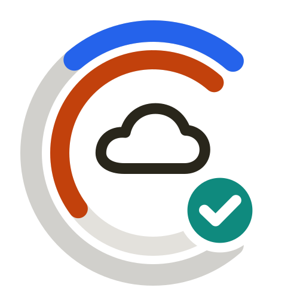
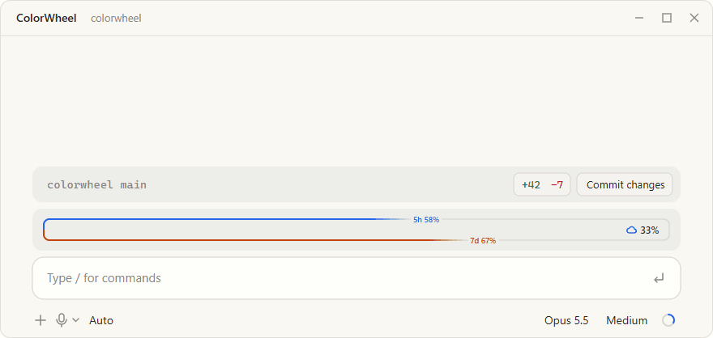
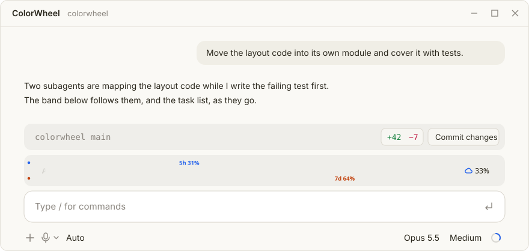
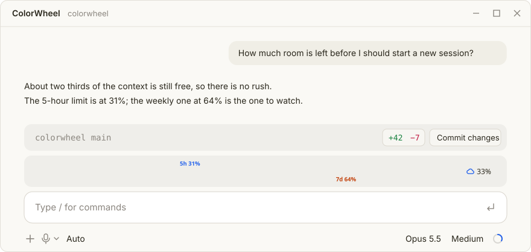

<p align="center"></p>

<h1 align="center">ColorWheel</h1>

<p align="center">Themed replies, full-width diagrams, and your context and limits at a glance, in Claude Code Desktop.</p>

<p align="center"></p>

---

ColorWheel is a [Claude Code](https://docs.anthropic.com/en/docs/claude-code) mod. It changes two places in the desktop app: how assistant replies are drawn, and the band above the prompt.

## The band above the prompt



One rounded frame sits inside the app's own block and is always there.

- **The top edge is the 5-hour limit, the bottom edge the 7-day limit.** Each line grows from the left as the limit is used, and its percent rides on the edge where the colour ends. Hover an edge for the time to reset.
- **The context window is the weather on the right.** Clear, cloudy, showers, storm, then *compact soon*, with the percent used. Hover it for tokens, the last twelve turns and the trend.
- **Subagents and tasks fill the inside.** While they run, the frame shows how many agents are running and done, tasks done over total and the item in progress, and a wash grows from the left. When everything is finished it says *All done* for a few seconds.

The last known limits are kept between sessions, so a new session shows them at once.



## Replies

- Text, lists and tables go through the app's own markdown renderer, so they keep its typography, wrap to the chat width and follow light and dark mode.
- Code blocks use the app's native code view.
- GitHub alerts (`> [!NOTE]`, `[!TIP]`, `[!IMPORTANT]`, `[!WARNING]`, `[!CAUTION]`) become rounded cards in a tone that reads on both themes.
- Mermaid flowcharts, state and sequence diagrams and `xychart-beta` charts draw as full-width SVG that switches with the theme. Each has **Open large**, a pane that zooms from 100 to 600% with panning, and **Copy source**.

<p>
  
  
</p>

The terminal keeps Claude Code's own renderer and a one-line version of the band.

## Install

```sh
claude plugin marketplace add AlexeyHRDesign/colorwheel
claude plugin install colorwheel@colorwheel --scope user
```

Restart Claude Code after installing. From a local checkout, pass the folder path to `marketplace add` instead.

The installer may say that two options are not set yet; both default to on, so there is nothing to configure. ColorWheel needs a Claude Code build with mods (plugins with a `hooks` module).

> [!NOTE]
> ColorWheel is tested only on Windows, in the desktop app on Claude Code 2.1.295, at one screen size and scale. It has not been tried on macOS or Linux, or at other resolutions and display scaling, where the frame may sit a few pixels off. If you run it there, an [issue](https://github.com/AlexeyHRDesign/colorwheel/issues) with a screenshot is very welcome.

ColorWheel draws the whole band above the prompt. Another mod that draws there without handing the band on will hide it; Token Weather is one, and ColorWheel replaces it.

## Use

| Command | What it does |
|---|---|
| `/colorwheel` | Shows every element ColorWheel draws. |
| `/colorwheel progress` | Plays a 20-second demo of agents and tasks in the band. |

Two settings, under the plugin's options:

| Setting | Default | |
|---|---|---|
| Enabled | on | Off hands replies back to Claude Code's own renderer. |
| Diagram hints | on | Adds a short note to each prompt so Claude knows diagrams and alerts render here. |

## Develop

```sh
npm --prefix scripts install
npm --prefix scripts run build:vendor
claude plugin validate .
claude plugin test .
npx tsx scripts/readme-images.ts
npx tsx scripts/readme-gif.ts
```

The engine refuses modules over 1 MiB, so the vendor build bundles only beautiful-mermaid's elk-free pipelines and fails if the bundle grows past that. Flowcharts are laid out by `hooks/layout.ts`. The README images are drawn by the mod's own code, so they match what it draws.

## Thanks

ColorWheel grew out of two mods:

- [prismantis](https://github.com/NahumLitvin/prismantis) by [Nahum Litvin](https://github.com/NahumLitvin), which showed how far a Claude Code mod can take the look of a reply.
- [Token Weather](https://github.com/anthropics/claude-code-playground/tree/main/claude-code/mods/token-weather) by [addy-ant](https://github.com/addy-ant), from the Claude Code playground, which first turned the context window into a forecast above the prompt. ColorWheel's weather and its band started from it.

## Credits

Made by Aleksei Druzhkov.

[ArtStation](https://www.artstation.com/hrdesign) · [LinkedIn](https://www.linkedin.com/in/alexey-druzhkov-8430a6183/) · [GitHub](https://github.com/AlexeyHRDesign)

## License

MIT. Bundles [beautiful-mermaid](https://github.com/lukilabs/beautiful-mermaid) (MIT).
